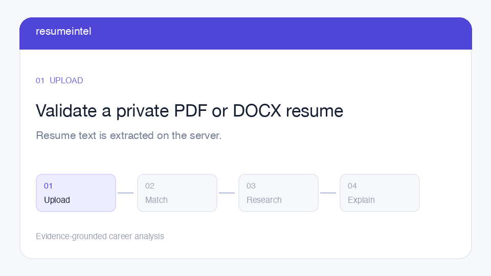
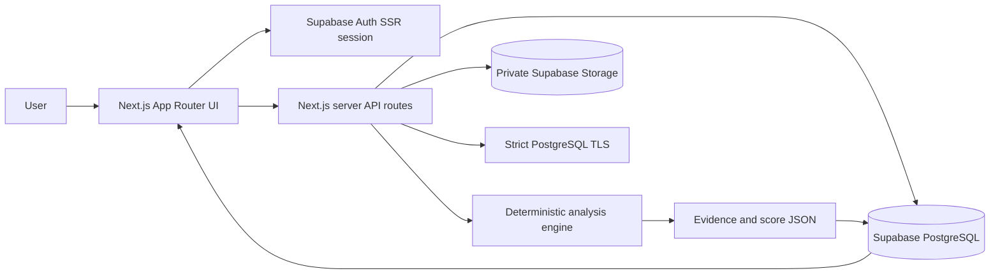
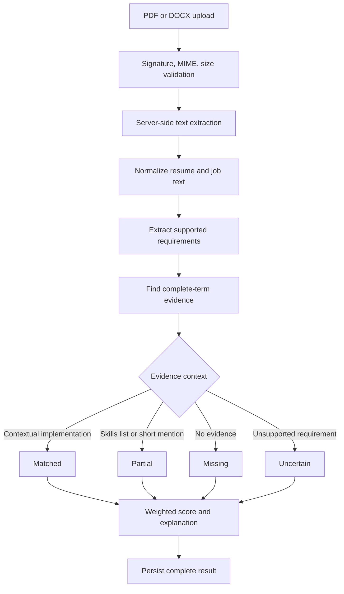
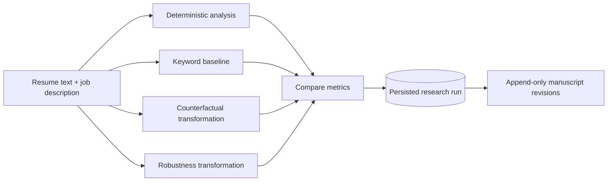

# ResumeIntel

Evidence-grounded resume analysis and reproducible research for resume-to-job matching.

ResumeIntel turns a resume and a target job description into an inspectable report:

- requirement-by-requirement match states
- source-grounded evidence excerpts
- weighted score breakdowns
- uncertainty-aware proficiency estimates
- persisted analysis, research, and manuscript history

> ResumeIntel is a decision-support tool. Its score is not a hiring probability, employer ATS score, or substitute for human review.

## Product walkthrough



The workflow is:

1. Authenticate securely.
2. Upload a PDF or DOCX resume.
3. Extract and validate resume text on the server.
4. Compare resume evidence with job requirements.
5. Inspect the score, evidence, uncertainty, and recommendations.
6. Run reproducible counterfactual, robustness, or baseline research.
7. Save manuscript revisions without overwriting prior versions.

The bundled animation is a lightweight workflow illustration. It is not a browser recording; use the local app for a live product demonstration.

## Why the approach is research-oriented

ResumeIntel treats matching as an evidence-analysis problem rather than a binary keyword lookup.

| Research concern | ResumeIntel approach |
| --- | --- |
| Reproducibility | Deterministic analysis engine and persisted JSON results |
| Explainability | Evidence excerpts, sections, methods, and score contributions |
| Uncertainty | Separate `partial`, `uncertain`, and `missing` states |
| Robustness | Counterfactual and qualification-preserving experiments |
| Baselines | Keyword baseline for comparison with contextual matching |
| Auditability | Authenticated ownership, append-only revisions, and timestamps |

## System architecture



## Analysis pipeline



## Research workspace



Supported experiment types:

- **Counterfactual:** measure how a controlled evidence change affects the result.
- **Robustness:** test whether conclusions survive meaning-preserving transformations.
- **Baseline:** compare contextual evidence matching with keyword-only matching.

Useful research metrics include requirement coverage, score delta, missing-evidence count, uncertainty count, qualification preservation, and reproducibility across repeated runs.

## Evidence states and scoring

| State | Meaning | Credit |
| --- | --- | ---: |
| `matched` | Contextual resume evidence supports the requirement | `1.00` |
| `partial` | Term is present, but context is limited | `0.55` |
| `uncertain` | Requirement cannot be mapped reliably | `0.35` |
| `missing` | No recognizable evidence was found | `0.00` |

Required requirements have weight `5`; preferred requirements have weight `3`.

```text
score = sum(requirement_weight × state_credit)
        / sum(requirement_weight) × 100
```

The score is an evidence-coverage metric, not a prediction of candidate success.

## Technology

- **Frontend:** Next.js App Router, React, TypeScript
- **Authentication:** Supabase Auth with server-side session verification
- **Database:** Supabase PostgreSQL with Row Level Security
- **Storage:** Private Supabase Storage bucket
- **Parsing:** `pdfjs-dist` and `mammoth`
- **Research:** Deterministic TypeScript analysis and experiment modules
- **Validation:** Vitest, ESLint, TypeScript, Next.js production build
- **Deployment:** Vercel

## Security model

- User ownership is derived from the verified server-side Supabase session.
- Browser-supplied owner IDs are never trusted.
- Public browser variables are limited to the Supabase URL and publishable key.
- Secret keys, database credentials, and CA certificates remain server-only.
- RLS policies scope database records to `auth.uid()`.
- Resume objects use owner-prefixed private Storage paths.
- PostgreSQL TLS keeps certificate and hostname verification enabled.
- Failed upload-to-analysis workflows use owner- and workflow-token-scoped cleanup.

## Local development

### Requirements

- Node.js compatible with the tested project toolchain
- pnpm `12.3.4`
- A Supabase project with the schema applied

### Setup

```bash
pnpm install
cp .env.example .env.local
```

Set the required local values in `.env.local`:

```text
NEXT_PUBLIC_SUPABASE_URL=
NEXT_PUBLIC_SUPABASE_PUBLISHABLE_KEY=
DATABASE_URL=
SUPABASE_DB_CA_CERT=
```

Use `DATABASE_CA_CERT_PATH` only when a trusted CA file is mounted at a deployment-specific path. Never disable TLS verification.

Apply the reviewed SQL scripts in the intended Supabase environment:

```text
supabase/schema.sql
supabase/phase1-audit.sql
supabase/phase2-functional-remediation.sql
```

Start the application:

```bash
pnpm dev
```

Open `http://localhost:3000`.

## Validation

```bash
pnpm test
pnpm lint
pnpm build
pnpm db:verify
git diff --check
```

The live two-user audit is intentionally separate from production configuration:

```bash
pnpm security:integration
```

Use only a dedicated non-production `.env.audit.local`. Test credentials must never be configured in Vercel Production.

## Deployment checklist

Configure these Vercel Production variables:

```text
NEXT_PUBLIC_SUPABASE_URL
NEXT_PUBLIC_SUPABASE_PUBLISHABLE_KEY
DATABASE_URL
SUPABASE_DB_CA_CERT
```

Before deploying:

- confirm `workflow_token` and its partial index exist in the target database
- confirm RLS and private Storage policies are enabled
- configure Supabase Auth site and redirect URLs for the Vercel domain
- remove all `SUPABASE_TEST_USER_*` variables from Production
- run the test, lint, and build checks
- perform a non-destructive authenticated smoke test

## Project structure

```text
app/
  api/                 Authenticated API routes
  page.tsx             Dashboard and workflow orchestration
components/
  research-workspace.tsx
lib/
  analysis.ts          Requirement matching and scoring
  research.ts          Reproducible research experiments
  resume-extraction.ts PDF/DOCX extraction and validation
  auth.ts              Server-side authenticated user lookup
  db.ts                Strict-TLS PostgreSQL pool
supabase/
  schema.sql
  phase1-audit.sql
  phase2-functional-remediation.sql
scripts/
  verify-db-connection.mjs
  supabase-rls-storage-audit.mjs
tests/
```

## Future research directions

- Compare deterministic evidence matching with expert annotations.
- Measure score stability under semantically equivalent rewrites.
- Evaluate calibration between confidence labels and expert judgments.
- Detect keyword stuffing and shallow skill-list inflation.
- Study fairness across alternate wording and resume structures.
- Measure human reviewer time saved by evidence-linked explanations.

## License

No license has been selected for this repository yet.
